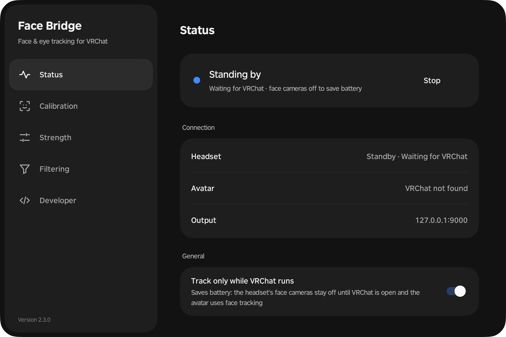
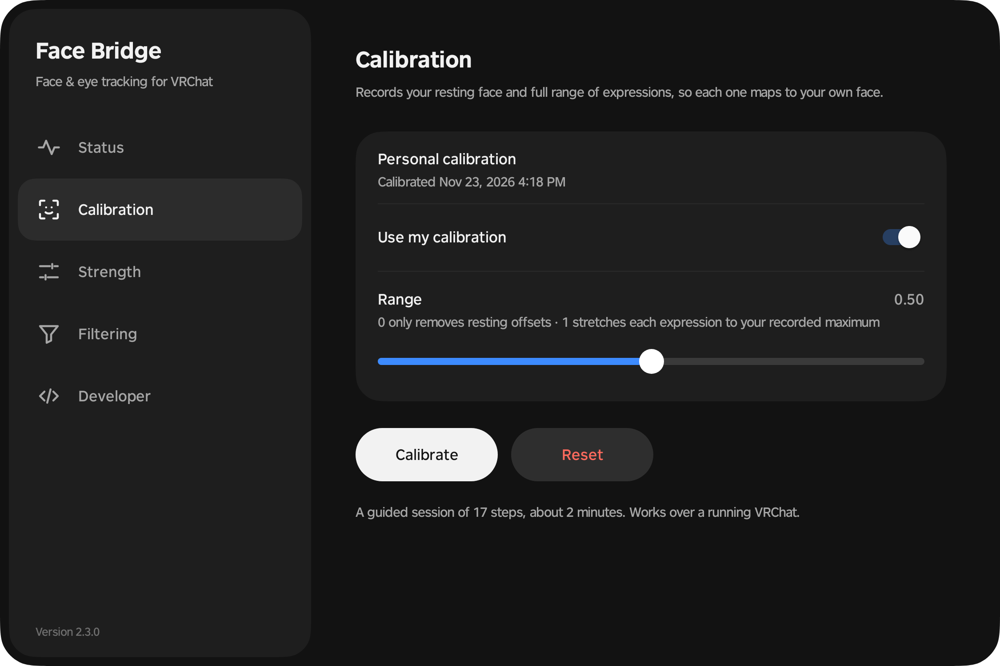
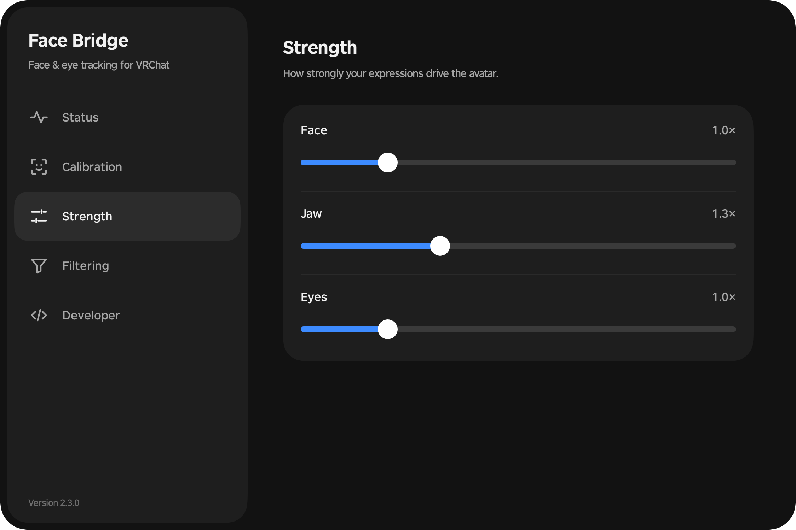
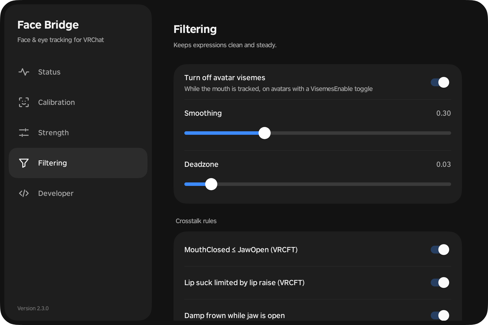
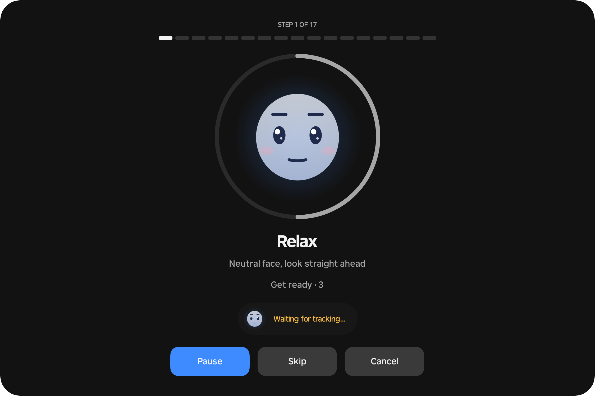
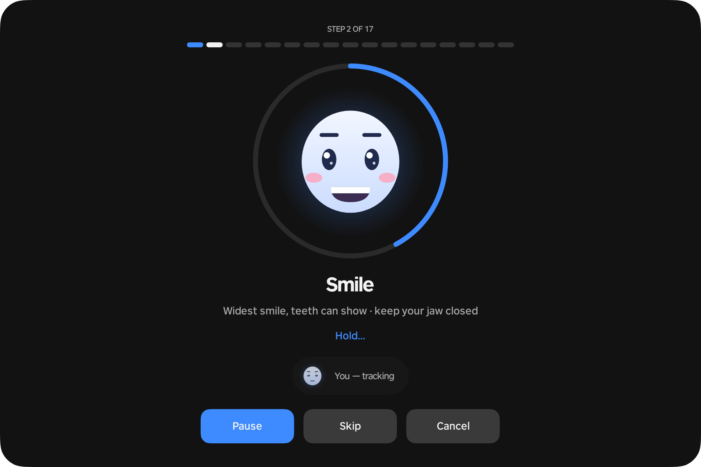

# Face Bridge

**CAUTION! SHIT IS VIBECODED AF. looks nice tho, and works dope**

**PICO 4 Pro / Enterprise face & eye tracking for standalone VRChat — no PC, no root.**

Face Bridge is a small Android app that runs on the headset next to VRChat. It reads PICO's
face and eye tracking and streams it to VRChat over OSC, so your avatar's face moves while you
play standalone: in VRChat's own face tracking format, as VRCFaceTracking (VRCFT v2) avatar
parameters, or both.

<p align="center">
  
</p>

## Features

- **Works with standalone VRChat** on the headset. No PC? No problem.
- **Both VRChat face tracking formats.** It finds VRChat through OSCQuery and reads the current
  avatar's parameters. VRCFT v2 avatars (`FT/v2/…`, binary-synced copies, sign bits) get exactly
  the parameters they have. Avatars with VRChat's built-in face tracking get the native
  `/tracking/face/v1` data.
- **Eye tracking.** Eye bones and eyelids move through VRChat's OSC eye tracking.
- **Turns off avatar visemes while lips are tracked** on avatars with a `VisemesEnable` toggle,
  so microphone visemes don't stack on top of tracked lips. The toggle is restored when the bridge stops.
- **Battery-aware.** PICO's face cameras only run while they are used: the headset is awake,
  VRChat is running and the current avatar has face tracking. Otherwise the bridge stands by with
  the cameras off.
- **Personal calibration.** A 2-minute guided session (17 expressions) maps your real
  range of motion to 0–1 for each expression.
- **Tuning.** Separate face, eye and jaw strength, plus crosstalk filters, a deadzone and One Euro smoothing.
- **Native interface in the PICO OS 5 style.** It opens as a "near" panel over a running VRChat, so you can change
  settings without leaving the game.

## Screenshots

| Status | Calibration | Strength |
|---|---|---|
|  |  |  |

| Filtering | Guided calibration | Calibration step |
|---|---|---|
|  |  |  |

## Requirements

- **PICO 4 Pro or PICO 4 Enterprise** (the models with face/eye tracking cameras).
- **PICO OS 5.x.** Developed and tested on 5.13.3. Other firmware may change the tracking service
  protocol (see [Limitations](#limitations)).
- **VRChat** for Android/PICO with **OSC enabled**.
- A PC with `adb` for the one-time install and permission grant.

## Installation

1. Enable **Developer mode** on the headset and connect it to the PC with USB
   (accept the USB debugging prompt in the headset).
2. Download `FaceBridge-vX.Y.Z.apk` from the [Releases](../../releases) page and install it:

   ```bash
   adb install -r FaceBridge-v2.2.3.apk
   ```

3. Grant the tracking permissions. PICO shows no dialog for them, so use adb:

   ```bash
   adb shell pm grant io.github.staperfeed.facebridge com.picovr.permission.FACE_TRACKING
   ```

   ```bash
   adb shell pm grant io.github.staperfeed.facebridge com.picovr.permission.EYE_TRACKING
   ```

4. Recommended: let the bridge keep running in the background while the headset idles:

   ```bash
   adb shell dumpsys deviceidle whitelist +io.github.staperfeed.facebridge
   ```

Upgrading from a build older than 2.3.0 (app ID `com.pico.vrcft.standalone`)? Uninstall it first
(`adb uninstall com.pico.vrcft.standalone`), because the new version installs as a separate app.

## Usage

1. Open **Face Bridge** from the library and press **Start**.
2. Launch **VRChat** → Action Menu → Options → **OSC → Enabled**.
3. Switch to an avatar with face tracking. The status page shows the avatar and how many face
   tracking parameters it has. Tracking starts on its own.

You can reopen Face Bridge while in VRChat: press the PICO button → dock → Face Bridge. It opens as
a panel in front of the game without closing it.

**Calibration** (optional, recommended): Calibration → **Calibrate**, then follow the mascot.
Each step shows "Get ready" for 3 seconds, then you hold the expression for 2.5–5 seconds. One beep
marks the start of a hold and a double beep its end, so you can do the "Close your eyes" step
without seeing the screen. **Range** sets how much of your recorded maximum is stretched to 1.0
(0 = only remove the resting offset).

### Status messages

| Status | Meaning |
|---|---|
| **Tracking** | Face data is flowing to VRChat. |
| Standing by · Waiting for VRChat | VRChat is not running. The cameras are off. |
| Standing by · Avatar has no face tracking | The current avatar has no VRCFT or native face tracking parameters. The cameras are off. |
| Standing by · Headset asleep | The headset display is off. Tracking resumes as soon as it wakes. |
| Put on the headset | PICO refuses to start tracking while the headset is not worn. |

**Track only while VRChat runs** (Status → General, on by default) can be turned off to keep
tracking on outside VRChat, for example while testing.

## Battery

The bridge process itself costs 1–2 % of one CPU core. The real cost is PICO's face tracking
(algorithm + IR cameras), which the bridge switches on. Measured on a PICO 4 Pro
([docs/power-baseline.md](docs/power-baseline.md)):

| Situation | Extra power |
|---|---|
| Home screen, tracking on | +1.03 W (+14 %) |
| In VRChat, tracking on | +0.47 W (+4.7 %): VRChat already keeps PICO eye tracking running |
| Standing by | ~0 W: cameras off, no wake lock |

## How it works

```
pxreyetrackingservice (PICO Binder service)
  ├─ StartAlgorithm / StopAlgorithm                 face + eye tracking on/off
  └─ GetSharedMemory(face) → read-only ashmem ring  52 PICO shapes, ~23 frames/s
        │
native loop (C++, 60 Hz, no allocations)
  calibration → mapping (ARKit → Unified Expressions) → crosstalk rules → deadzone → gain → One Euro
        │
UDP 127.0.0.1:9000 (OSC)
  ├─ /tracking/face/v1                 avatars with VRChat's built-in face tracking
  ├─ /avatar/parameters/…/v2/…         VRCFaceTracking avatars (bundled, only changed values)
  └─ /tracking/eye/*                   eye bones and eyelids
```

This needs no OpenXR session, so it keeps working while VRChat has focus. The details (ring
layout, the VRCFT parameter derivation, filters, calibration math) are in
[docs/TECHNICAL.md](docs/TECHNICAL.md).

## Limitations

- **Firmware-specific.** The Binder transactions and the shared-memory layout of PICO's tracking
  service are undocumented. They were verified on PICO OS 5.13.x, and an update can break them; the bridge
  then reports `face ring rejected` instead of sending garbage.
- **Orphaned tracking after a forced kill.** PICO's tracking service counts clients per process.
  If the bridge is killed without stopping tracking (force-stop, reinstall, out of memory), the
  service keeps the cameras on until the headset reboots. Normal exits (Stop, the notification's
  Stop action, standby) always stop tracking.
- **VRChat detection** treats an occupied UDP port 9000 on the headset as "VRChat is running" when
  OSCQuery is unavailable.
- If the bridge is killed while it has the avatar's visemes turned off, turn `VisemesEnable` back
  on in the avatar menu.

## Building

Requirements: Android SDK (platform 35), NDK 26.1.10909125, CMake 3.22.1, JDK 17+. The Gradle
wrapper is included.

```bash
./gradlew assembleRelease
```

The APK is written to `app/build/outputs/apk/release/app-release.apk`. Without a release key
(see [docs/RELEASING.md](docs/RELEASING.md)) it is signed with your local debug key, so it can
be installed directly.

## adb reference

The control entry points are protected by `android.permission.DUMP`, so only adb (or the system) can use
them and other apps on the headset cannot.

```bash
adb shell am start -n io.github.staperfeed.facebridge/.AdbControl --ei autostart 0
```

`--ei autostart 0` starts the bridge (`3` = test pattern, `-1` = stop). `--ez calibrate true` opens calibration.
`--ez screenshots true` saves PNGs of every page to
`/sdcard/Android/data/io.github.staperfeed.facebridge/files/screenshots`.

While VRChat is in front (PICO does not open activities over a VR app), start the service directly.
Optional extras (saved): `--ef face_gain 1.5 --ef eye_gain 1.5 --ez eye_osc true --ei filters 0x35f --ef deadzone 0.08 --ef smoothing 0.3`.

```bash
adb shell am start-foreground-service -n io.github.staperfeed.facebridge/.OscBridgeService -a io.github.staperfeed.facebridge.START --ei source 0
```

Logs (one diagnostic line per second in Developer mode, which you turn on by tapping the "Face Bridge" title 7 times):

```bash
adb logcat -s VrcftBridge EyeTrackingService
```

## Credits

- [PicoFacialBridge](https://github.com/WolalaQAQ/PicoFacialBridge) (MIT): the method for
  accessing PICO's tracking service, which this project ports.
- [UnifiedPicoModule](https://github.com/WolalaQAQ/UnifiedPicoModule) (MIT) and
  [VRCFaceTracking](https://github.com/benaclejames/VRCFaceTracking) (Apache-2.0): the
  post-processing rules and filters, re-implemented here.
- [Baballonia](https://github.com/Project-Babble/Baballonia) by Project Babble: the idea for the
  per-expression calibration.

See [THIRD_PARTY_NOTICES.md](THIRD_PARTY_NOTICES.md). Face Bridge is an independent project and is
not affiliated with PICO, ByteDance or VRChat.

## License

MIT — see [LICENSE](LICENSE). Third-party notices: [THIRD_PARTY_NOTICES.md](THIRD_PARTY_NOTICES.md).
